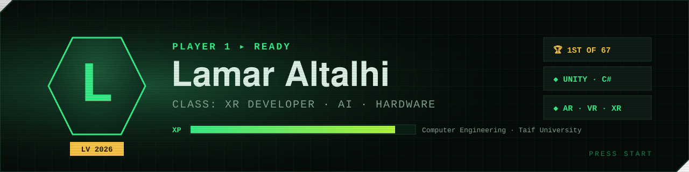

  
  

### 🎮 About me
Computer Engineering graduate from **Taif University** building games and immersive experiences with **Unity**. I work across **AR, VR and AI**, and I'm currently in the **Emerging Technologies & Virtual Worlds Bootcamp** at Tuwaiq Academy.

- 🏆 Hardware team member on **AquaVenture**, the AI-powered underwater robot that won **1st place among 67** graduation projects
- 🥽 Building AR games with **Unity + Vuforia** and VR experiences for **Meta Quest**
- 🤖 Worked on **Ramlah**, a bilingual RAG chatbot, during my co-op at **Rimal X**
- 🌱 Currently leveling up in **VR, MR and AR**

### 🕹️ Featured projects

| | Project | What it is |
|:--:|:---|:---|
| 🤖 | **[Ramlah AI](https://github.com/EngLamar/Ramlah-AI-Chatbot)** | Bilingual RAG chatbot for Rimal X · Next.js, Supabase, Groq |
| 🎤 | **[TEDxOkadh](https://github.com/EngLamar/TedxOkadh)** | Official website for TEDxOkadh 2026 · volunteer web team |
| 🌊 | **AquaVenture** | Bio-inspired underwater robot · YOLO + SLAM · 🏆 1st place |
| 🔥 | **VR Firefighter Simulation** | 2-player co-op VR · Meta Quest + Logitech G29 wheel |
| 🌀 | **Portal World VR Adventure** | Bilingual VR game with Desert, Snow and Beach worlds |
| 🐧 | **AR Penguin Mini-Game** | Unity + Vuforia AR game with image-triggered effects |
| 🏎️ | **AR Racing Challenge** | Co-developed AR racing game with an augmented track |

### 🧰 Tech stack

  
  
  
  
  
  
  
  
  

### 🏅 Certificates
**IBM** Cybersecurity Essentials · Security Operations &nbsp;|&nbsp; **ISC2** Network & Communications Security · Systems & Application Security &nbsp;|&nbsp; **SDAIA** Fundamentals of AI &nbsp;|&nbsp; **UC Davis** Principles of Secure Coding

🇸🇦 Saudi Arabia · Arabic & English

